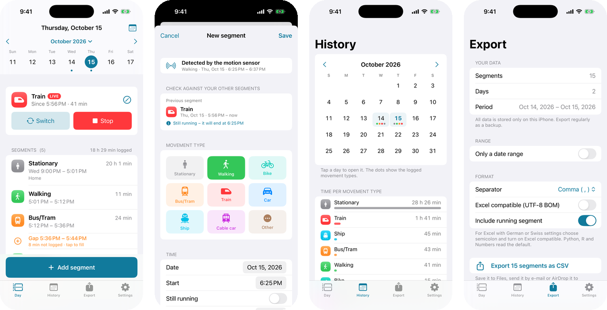
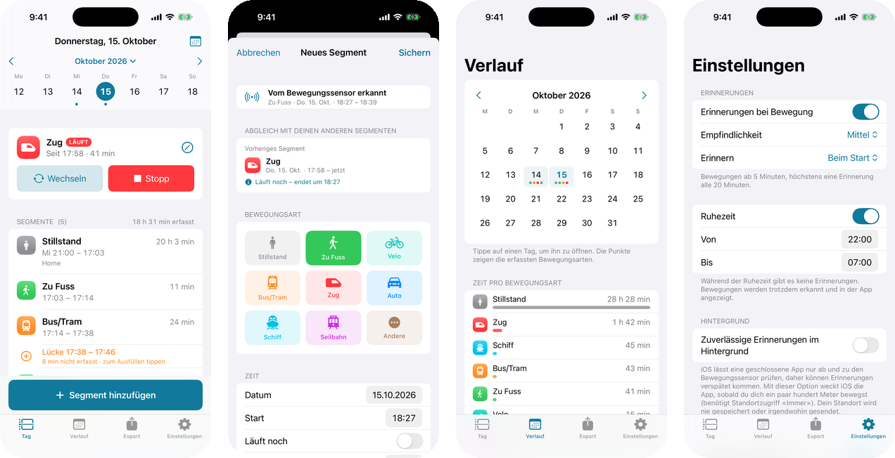
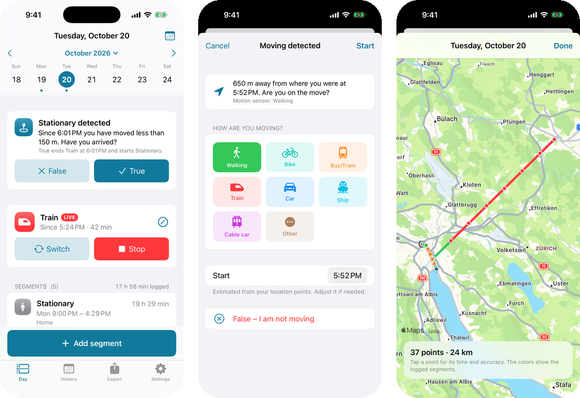
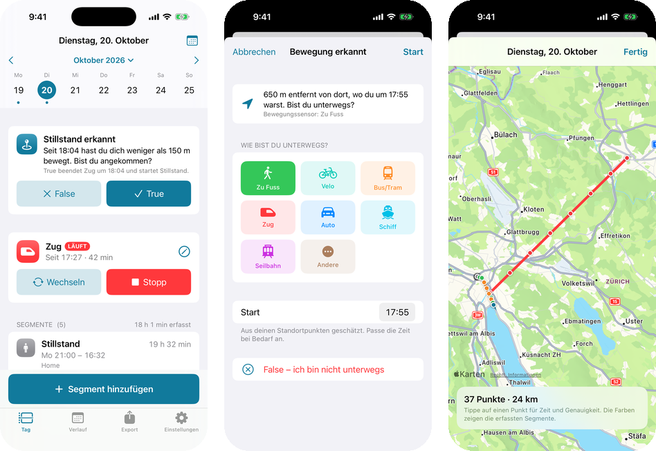

# Segment Validator (iPhone app)

Log your day as **movement segments** – start time, end time and movement type – to build a
ground truth for validating trip/mode segmentations. The iPhone's motion sensor notices when
you start moving and **reminds you to log the segment**, with the day and the times already
filled in and the previous segment shown so you can check that everything connects.
Optionally the app saves a **GPS location point every 5 minutes** and asks *Moving detected?* or
*Stationary detected?* – you answer **True** or **False**. Everything is exported as **CSV**.

- 📱 Native SwiftUI app for iPhone (iOS 17+), English and German (follows the iPhone language)
- 🔒 All data stays on the phone – no account, no server, no costs
- 🧪 Core logic covered by unit tests that run in GitHub Actions



<details>
<summary>Deutsch / German</summary>



</details>

## Features

**Logging**
- Movement types: `stationary`, `walking`, `bike`, `bus/tram`, `train`, `car`, `ship`, `cablecar`, `other`
- **Live logging**: tap a type when you start ("What are you doing right now?"), tap *Stop* when
  it ends, or *Switch* to change the type without a gap
- **Shortcuts, Siri and the Action Button**: *Start segment* (with a movement type) and *Stop segment*
  are available as Shortcuts actions, e.g. "Start Bus/Tram in Segments" or on the iPhone's Action Button
- **Any day**: pick a date in the week strip or the calendar and add segments with *Add segment*.
  New segments start where the day's last segment ended
- **Validation while editing**: the editor shows the *previous* and *next* segment and whether they
  connect seamlessly, leave a gap or overlap – with one-tap fixes ("Start at 08:12")
- Gaps between segments are highlighted and can be filled with one tap; overlaps are marked
- Segments may cross midnight (e.g. stationary 22:30 – 06:45)

**Motion sensor**
- **Reminders** (local notifications) when a new movement is detected – deliberately *not too
  sensitive*: three sensitivity levels, a minimum movement duration, a cooldown between reminders
  and quiet hours (default 22:00 – 07:00)
- Remind at the start of a movement (default), at the end, or both. Actions on the notification:
  *Log segment* or *Remind me in 15 min*
- Tapping a reminder opens the editor with day, start, end and type pre-filled. A trip with several
  detected parts (walk → tram → walk) is offered part by part (*Save & next*)
- **Detected movements** on the day screen: movements that are not logged yet, ✓ to add, ✕ to hide.
  iOS keeps this sensor history for 7 days
- **Forgotten live segment?** If a moving segment (e.g. *Walking*) is still running but the phone has been
  lying still for 15+ minutes, the app asks you to end it – with the time you stopped filled in

**Location points (GPS, optional)** – *Settings → Location (GPS) → Record location points*



<details>
<summary>Deutsch / German</summary>



</details>

- Every 5 minutes (adjustable: 1–30 min) the app saves a location point. GPS is switched on for a few
  seconds per point only; in between iOS uses the cell network, which costs very little battery
- **Moving detected – True / False**: while you are stationary (a *Stationary* segment or none is running)
  and a point is more than **400 m** away from the previous point (or from where you stayed, so slow
  walks count too). *True* opens the app: pick the movement type, the start is filled in (from the
  location points and, if available, the motion sensor). *False* just dismisses the question
- **Stationary detected – True / False**: while a moving segment is running and you moved less than
  **150 m** in one interval. *True* ends the moving segment where you stopped and starts *Stationary* –
  directly from the notification, without opening the app
- Touch and hold the notification to see the buttons. The open question is also shown at the top of
  the day screen. Each question comes once; the next one only after you stayed somewhere again or moved
  on. Both distances are adjustable, quiet hours apply
- While location points are recorded, these questions replace the motion sensor reminders, so you never
  get two notifications for the same movement
- **Map** of each day's points on the day screen, colored by the logged movement type. Tap a point for
  its time, accuracy, distance and your answer
- The answers are stored with the points (`prompt`, `answer` columns), so the detection can be evaluated

**Data**
- CSV export of everything or a date range, comma or semicolon separated, optional UTF-8 BOM for
  Excel; share via Files, AirDrop, Mail, …
- CSV import (backup/restore, moving to a new iPhone) – existing segments are updated, nothing is deleted
- Separate CSV export of the location points (same range and format options)
- Month overview with the logged movement types per day and the time per type

## How the reminders work (and what iOS allows)

iOS does not let an app read the accelerometer continuously while it is closed. The app therefore
uses **Core Motion activity** – computed from the accelerometer by the iPhone's motion coprocessor,
very battery friendly and stored by iOS for 7 days. Whenever the app gets a chance to run, it looks
at this history, groups it into movements (short stops like traffic lights do not split a trip,
short sensor flickers are ignored) and sends a reminder for movements you have not logged yet.

When does the app get a chance to run?

| Trigger | Needs | Timing |
|---|---|---|
| Background App Refresh | nothing (Background App Refresh on) | decided by iOS – sometimes every ~15 minutes, sometimes hours |
| **Reliable background reminders** (Settings → Background) | location access "Always" | iOS wakes the app after you moved a few hundred meters, so reminders arrive within minutes |
| **Location points** (Settings → Location (GPS)) | location access "Always" recommended | every 5 minutes; the app keeps running in the background |
| Opening the app | – | detected movements are always shown on the day screen |

With *Reliable background reminders* the location is only a wake-up signal and is not stored. With
*Record location points* the points are stored – on the iPhone only. Because the start time always
comes from the sensor history, a reminder that arrives late still suggests the correct start time.
*Settings → Test* sends a test reminder or a test GPS question and lets you run a check manually.

To keep taking points in the background, the app keeps a very coarse location update running between
two points (cell network only, GPS off) and asks for GPS accuracy for a few seconds every 5 minutes.
If iOS ends the app anyway (or you swipe it away), it is relaunched after the next larger movement
(location access "Always" needed). Approximate location is not enough – keep *Precise Location* on.

## Install on your iPhone – free

You do **not** need the paid Apple Developer Program. With a free Apple ID the app is signed for
7 days; after that, simply install it again (your data is kept as long as you don't delete the app).

### Option A – without Xcode (works on any Mac or Windows PC)

Every push to `main` builds the app in GitHub Actions and publishes it as
**[SegmentationValidator.ipa](https://github.com/janaruto/segmentationValidatorApp/releases/latest/download/SegmentationValidator.ipa)**
(unsigned). [Sideloadly](https://sideloadly.io) signs it with your free Apple ID and installs it:

1. Install Sideloadly (macOS or Windows) and download `SegmentationValidator.ipa` from the link above.
2. Connect the iPhone with a cable, unlock it and tap *Trust This Computer*.
3. Drag the IPA into Sideloadly, enter your Apple ID and click *Start*. (Sideloadly only uses the
   Apple ID to create the free signing certificate. You can also use a separate Apple ID.)
4. On the iPhone: *Settings → Privacy & Security → Developer Mode* → on (restart), then
   *Settings → General → VPN & Device Management* → trust your Apple ID.
5. After 7 days, repeat step 3 with the same Apple ID. Your data is kept.

[AltStore](https://altstore.io) works the same way and can refresh the app automatically over Wi-Fi.

### Option B – with Xcode

Xcode needs a recent macOS (the current App Store version requires macOS 26.6). On an older macOS,
update macOS first, or download an older Xcode from
[developer.apple.com/download/all](https://developer.apple.com/download/all/) (free Apple ID).
The project needs **Xcode 16 or newer** (Xcode 16 runs on macOS 14.5+, Xcode 26 on macOS 15.6+).
Note that an older Xcode may not be able to install apps on an iPhone with a newer iOS – then use Option A.

1. `git clone https://github.com/janaruto/segmentationValidatorApp.git` and open
   `SegmentationValidator.xcodeproj`.
2. Xcode → *Settings → Accounts*: add your Apple ID.
3. Select the *SegmentationValidator* target → *Signing & Capabilities* → *Team*: your Apple ID
   ("Personal Team"). If Xcode says the bundle identifier is taken, change
   `com.janaruto.SegmentationValidator` to something unique (e.g. `ch.yourname.segments`).
4. Connect the iPhone with a cable, select it as run destination and press ▶︎.
5. On the iPhone: enable *Developer Mode* and trust your Apple ID as in Option A, step 4.

## CSV format

One row per segment, sorted by start time. Times are local time; the ISO columns include the UTC
offset and are the precise values.

| Column | Example | Description |
|---|---|---|
| `date` | `2026-10-15` | Day the segment starts |
| `start_time` | `08:12` | Local start time |
| `end_time` | `08:40` | Local end time (empty while running; may be on the next day) |
| `duration_min` | `28` | Duration in minutes |
| `movement_type` | `bus/tram` | `stationary`, `walking`, `bike`, `bus/tram`, `train`, `car`, `ship`, `cablecar`, `other` |
| `note` | `Tram 11` | Free text |
| `start_iso` | `2026-10-15T08:12:00+02:00` | Start, ISO 8601 with offset |
| `end_iso` | `2026-10-15T08:40:00+02:00` | End, ISO 8601 with offset |
| `timezone` | `Europe/Zurich` | Time zone used for the local columns |
| `source` | `reminder` | How the segment was created: `manual`, `live`, `suggestion`, `reminder`, `location` (answered a GPS question), `imported` |
| `detected_activity` | `automotive` | What the motion sensor detected, if the segment came from a detection |
| `id` | `6f9619ff-…` | Stable id (used by the import to update instead of duplicate) |
| `created_at`, `updated_at` | ISO 8601 | Audit timestamps |

```python
import pandas as pd
segments = pd.read_csv("segments.csv", parse_dates=["start_iso", "end_iso"])
```

### Location points CSV

One row per location point, oldest first (*Export → Location points*).

| Column | Example | Description |
|---|---|---|
| `date`, `time` | `2026-10-15`, `09:15:03` | Local date and time |
| `timestamp_iso` | `2026-10-15T09:15:03+02:00` | ISO 8601 with offset |
| `timezone` | `Europe/Zurich` | Time zone used for the local columns |
| `latitude`, `longitude` | `47.377912`, `8.540192` | WGS 84, degrees |
| `accuracy_m` | `8.0` | Horizontal accuracy (radius in meters). Points above 100 m are not used for the questions |
| `altitude_m`, `speed_mps` | `412.3`, `1.40` | If known |
| `distance_m` | `652` | Distance from the previous point in the file |
| `movement_type` | `walking` | The segment logged at that time (empty in gaps) |
| `trigger` | `interval` | `interval`, `app_opened`, `wake_up`, `manual` |
| `prompt` | `moving` | Question asked because of this point: `moving` or `stationary` |
| `answer` | `true` | Your answer: `true`, `false` or empty |
| `id` | `0b6f…` | Stable id |

## Privacy and data safety

- Segments are stored in a JSON file in the app's private storage on the iPhone (written atomically).
  Location points (only if you turned them on) are stored in one file per day next to it. Both are
  part of the normal iPhone/iCloud device backup. *Settings → Data* deletes the location points.
- Nothing is sent anywhere. Notifications are local notifications scheduled by the phone itself.
- Export a CSV now and then as an additional backup (*Export* tab).

## Development

```
SegmentationValidator/            the app (Xcode 16+ "synchronized folder": new files are picked up automatically)
├── App/                          app entry point, AppModel (state + glue), debug demo data
├── Core/                         platform independent logic: model, validation, detection, reminders,
│                                 location questions, CSV
├── Services/                     Core Motion, notifications, background refresh, location points and wake-ups
├── Views/                        SwiftUI screens
├── Support/                      formatting and UI helpers
└── Resources/                    assets, Localizable.xcstrings (German), InfoPlist.xcstrings
Tests/SegmentationCoreTests/      unit tests for Core (run with `swift test`, also on Linux)
Config/Info.plist                 permissions texts, background modes
scripts/                          helper scripts (string check, screenshots, icon, project check)
```

- **Unit tests**: `swift test` (macOS or Linux). `Package.swift` exposes `SegmentationValidator/Core`
  as a library, so the logic is tested without a simulator.
- **CI** (`.github/workflows/ci.yml`): unit tests on Linux, unsigned iPhone build on macOS, IPA artifact.
- **Screenshots** (`.github/workflows/screenshots.yml`, run manually): screenshots of all screens in
  English and German from the iOS Simulator, pushed to the `ci-screenshots` branch.
- **Demo data** (debug builds only): launch with `-debugSeedDemoData YES -debugFakeDetections YES`,
  see `SegmentationValidator/App/DemoData.swift`.
- **Translations**: edit `Localizable.xcstrings` in Xcode; `python3 scripts/check_strings.py` lists
  texts without a German translation.

## Costs

None: Xcode is free, a free Apple ID is enough to install the app on your own iPhone, local
notifications need no server, and GitHub Actions are free for public repositories.
